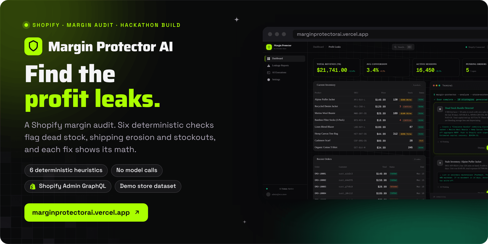
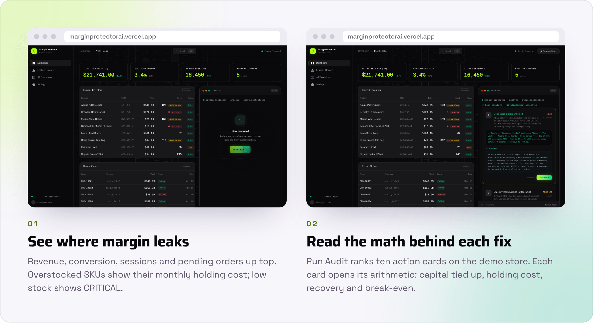
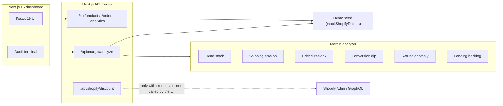

<div align="center">



<br><br>

<a href="https://marginprotectorai.vercel.app"></a>&nbsp;&nbsp;
<a href="https://bazaar.it/share/547d4ade-3864-4d3e-9ce6-52e7d152f229"></a>&nbsp;&nbsp;
<a href="#the-six-heuristics"></a>

<br><br>

<a href="https://marginprotectorai.vercel.app"></a>


<h3>See where a store loses margin, and the math behind every fix.</h3>

<b>Load</b> &nbsp;→&nbsp; <b>Audit</b> &nbsp;→&nbsp; <b>Rank</b> &nbsp;→&nbsp; <b>Explain</b> &nbsp;→&nbsp; <b>Preview</b>

<br>

<a href="#how-it-works">How it works</a> &nbsp;·&nbsp;
<a href="#the-six-heuristics">The six heuristics</a> &nbsp;·&nbsp;
<a href="#status">Status</a> &nbsp;·&nbsp;
<a href="#run-it-locally">Run it locally</a>

</div>

<br>

<picture>
  <source media="(prefers-color-scheme: dark)" srcset="docs/readme/screens-dark.png">
  
</picture>

<p align="center"><sub>Captured from a local production build (<code>next start</code>) on 30 October 2026 with the bundled demo dataset. The "Shopify Connected" label in the header is static: this build reads no store.</sub></p>

**Margin Protector AI is a Shopify profit-leak audit dashboard built at the OpenClaw Hackathon 2026.** It runs six deterministic heuristics over products, orders and daily analytics, ranks what it finds by urgency, and explains every recommendation with plain arithmetic (capital tied up, holding cost, recovery, break-even) rather than a model's guess. Today it runs on a bundled demo store: the dashboard does not read a live store, and its **Deploy Fix** button plays a scripted preview rather than calling Shopify.

Built by Matt ([RVAClassic](https://x.com/rvaclassic), [Operator Uplift](https://operatoruplift.com)) at the OpenClaw Hackathon 2026, March 2026.

<br>

## How it works

<picture>
  <source media="(prefers-color-scheme: dark)" srcset="docs/readme/flow-dark.png">
  
</picture>

The dashboard loads products, orders and analytics from three API routes, then posts to `/api/margin/analyze`, which runs [`src/lib/marginAnalyzer.ts`](src/lib/marginAnalyzer.ts) and returns action cards. Every number is computed from the data with fixed assumptions written into the code: a 2% monthly holding cost, a 35% clearance discount, 45% cost of goods, a $55 average order and a 3.5% benchmark conversion rate. The reasoning text also quotes fixed benchmark figures (for example, a 22% return reduction from fit quizzes) that are part of the template, not measurements.

<table>
  <tr valign="top">
    <td width="33%"><b>Deterministic</b><br><sub>The same data always produces the same cards. There is no language model in the analysis path, so nothing is invented between the numbers and the recommendation.</sub></td>
    <td width="33%"><b>Shows its work</b><br><sub>Each card has a description, a proposed execution and a collapsible <b>AI Thinking</b> panel with the dollar amounts, ROI and break-even behind it.</sub></td>
    <td width="33%"><b>Ready for Shopify, not wired to it</b><br><sub><code>POST /api/shopify/discount</code> can create a real discount code through the Admin GraphQL API when credentials are set. The dashboard does not call it yet.</sub></td>
  </tr>
</table>

<p align="center"><sub>Next.js 16.2 (App Router, Turbopack) · React 19 · TypeScript (strict) · Tailwind CSS 4 · shadcn/ui and Magic UI · Framer Motion 12 · Shopify Admin GraphQL API 2026-01 · Vercel</sub></p>

<br>

## The six heuristics

All six live in [`src/lib/marginAnalyzer.ts`](src/lib/marginAnalyzer.ts). On the demo seed they produce ten cards: one clearance bundle and three per-SKU stale-inventory alerts, one shipping alert, two restocks, one conversion campaign, one refund alert and one backlog alert.

| # | Heuristic | Trigger | Urgency | What it proposes |
|---|---|---|---|---|
| 1 | **Dead stock bundle** | Not archived, more than 50 units, 0 sold in 30 days | HIGH, plus a MEDIUM alert per SKU | A 35% clearance bundle; per SKU, a 40% markdown on secondary channels |
| 2 | **Shipping margin erosion** | Active, shipping cost above 40% of price | HIGH | Renegotiate the carrier rate, or raise the price by half the gap and A/B test it |
| 3 | **Critical restock** | Active, stock below the reorder threshold | HIGH | A purchase order for three times the threshold, expedited freight and a backorder page |
| 4 | **Conversion dip** | Any day below 3.0% conversion | MEDIUM | A 15% flash sale, abandoned-cart emails and $500 of retargeting |
| 5 | **Refund rate anomaly** | Refunds above 5% of orders | MEDIUM | Audit refunded orders, improve sizing guides, add a fit quiz |
| 6 | **Pending order backlog** | Four or more orders pending | LOW | Escalate old orders and send proactive delay notices |

<br>

## Status

<table>
  <tr valign="top">
    <td width="16%" align="center"></td>
    <td>Built at the OpenClaw Hackathon 2026; the last commit is from 28 March 2026. The demo deploys to <a href="https://marginprotectorai.vercel.app">marginprotectorai.vercel.app</a>, with the marketing page at <code>/landing</code>.</td>
    <td width="22%"><a href="https://marginprotectorai.vercel.app">Demo</a></td>
  </tr>
  <tr valign="top">
    <td align="center"></td>
    <td>The dashboard and every analysis route read the bundled seed in <code>src/lib/mockShopifyData.ts</code>, which is built to trigger all six heuristics. No route reads a live store's products, orders or analytics.</td>
    <td><a href="src/lib/mockShopifyData.ts">Demo seed</a></td>
  </tr>
  <tr valign="top">
    <td align="center"></td>
    <td><code>POST /api/shopify/discount</code> sends a real <code>discountCodeBasicCreate</code> mutation when <code>SHOPIFY_STORE_URL</code> and <code>SHOPIFY_ACCESS_TOKEN</code> are set, and returns a mock response (<code>"source": "mock"</code>) without them or after any Shopify error. In the dashboard, Deploy Fix shows a client-built payload and a scripted success message, and the restock preview shows a <code>purchaseOrderCreate</code> payload that is never sent.</td>
    <td><a href="src/app/api/shopify/discount/route.ts">Discount route</a></td>
  </tr>
</table>

<br>

## Run it locally

<table>
  <tr valign="top">
    <td width="33%"><b>Prerequisites</b><br><sub>Node 20.9 or newer (Next.js 16's minimum) and pnpm. No store or credentials are needed for the dashboard.</sub></td>
    <td width="33%"><b>Read first</b><br><sub><a href="src/lib/marginAnalyzer.ts"><code>marginAnalyzer.ts</code></a> for the rules and <a href="AGENTS.md"><code>AGENTS.md</code></a>: this Next.js version has breaking changes.</sub></td>
    <td width="33%"><b>What the checks prove</b><br><sub>Types and the production build. There is no test suite, and <code>pnpm lint</code> currently reports two React hook errors.</sub></td>
  </tr>
</table>

```bash
git clone https://github.com/operatoruplift/Margin-Protector-AI.git
cd Margin-Protector-AI
pnpm install
pnpm dev                 # http://localhost:3000, marketing page at /landing
```

```bash
pnpm build && pnpm start # production build
pnpm exec tsc --noEmit   # type check
pnpm lint                # ESLint with the Next.js config
```

To try the discount route against a real development store, copy [`.env.example`](.env.example) to `.env.local` and set both values. The route then posts to `https://<store>/admin/api/2026-01/graphql.json`; without them it answers with a mock.

| Variable | Used by |
|---|---|
| `SHOPIFY_STORE_URL` | `POST /api/shopify/discount`: the `your-store.myshopify.com` host |
| `SHOPIFY_ACCESS_TOKEN` | `POST /api/shopify/discount`: an Admin API access token that can create discounts |

```bash
curl -X POST http://localhost:3000/api/shopify/discount \
  -H 'content-type: application/json' \
  -d '{"sku": "APJ-BLK-L", "discountPercentage": 35, "productTitle": "Alpine Puffer Jacket"}'
```

<details>
<summary><b>API routes</b></summary>
<br>

| Route | Returns |
|---|---|
| `GET /api/products` | The 8 demo products |
| `GET /api/orders` | The 25 demo orders |
| `GET /api/analytics` | Seven days of demo analytics |
| `POST /api/margin/analyze` | Action cards from the six heuristics |
| `POST /api/agent/run` | The same output, kept for backward compatibility |
| `POST /api/shopify/discount` | A discount code from Shopify, or a mock without credentials |

The three data routes wait 400 ms before answering, to simulate a store API.

</details>

<details>
<summary><b>Architecture diagram</b></summary>
<br>



</details>

<details>
<summary><b>Repository layout</b></summary>
<br>

| Path | Contents |
|---|---|
| `src/app/page.tsx` | The dashboard: KPI ribbon, inventory, orders, audit terminal, action cards, reports, executions and settings views |
| `src/app/landing/page.tsx` | The marketing page |
| `src/app/api/` | The six API routes listed above |
| `src/lib/marginAnalyzer.ts` | The six-heuristic engine |
| `src/lib/mockShopifyData.ts` | The demo store seed |
| `src/types/index.ts` | Shared product, order, analytics and action types |
| `src/components/ui/` | shadcn/ui and Magic UI components |

</details>

<br>

<p align="center"><sub>No license file is published with this repository yet. The demo store, its products, orders and customers are fictional.</sub></p>

<p align="center"><sub>Built by <a href="https://rvaclassic.xyz">Matt Sim</a>, founder of <a href="https://operatoruplift.com">Operator Uplift</a>. More builds at <a href="https://github.com/operatoruplift">github.com/operatoruplift</a>. Want one built for your product? <a href="https://cal.com/rvaclassic/15min">Book a 15-minute call</a>.</sub></p>
